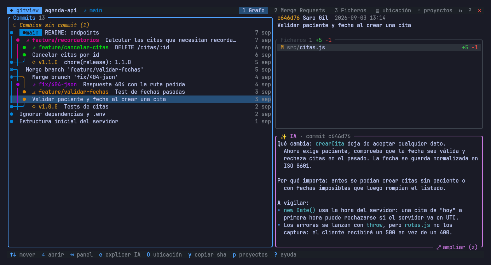
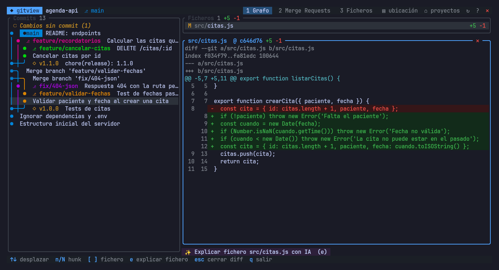

<div align="center">

# 🌿 herdr-gitview

### *El control de cambios de tus agentes, sin salir de la terminal*

[](https://www.rust-lang.org)
[](https://ratatui.rs)
[](https://herdr.dev)
[](https://cli.github.com)
[](https://gitlab.com/gitlab-org/cli)
[](#-instalación)
[](#-explicaciones-con-ia)
[](LICENSE)

**Grafo de commits al estilo Git Graph de VS Code, diffs, Pull Requests de GitHub, Merge Requests de GitLab y explicaciones breves con IA.
Un plugin de [herdr](https://herdr.dev) que se abre sobre el panel donde trabaja tu agente, y también funciona solo.**

</div>

---



## ✨ Qué hace

Cuando tienes varios agentes (Claude Code, Codex, OpenCode…) tocando repos a la vez, la pregunta es siempre la misma:
*¿qué ha cambiado aquí?* herdr-gitview te lo enseña en una ventana flotante con un atajo de teclado.

| Vista | Qué muestra |
|---|---|
| **1 · Grafo** | Todas las ramas con carriles de colores, ramas y tags, cambios sin commit, ficheros del commit y su diff |
| **2 · Pull Requests / Merge Requests** | PRs de GitHub o MRs de GitLab abiertos, fusionados, cerrados o todos, con ramas, checks/pipeline, commits, ficheros y diff |
| **3 · Ficheros** | Explorador con el estado git de cada fichero y su historial |



- 🎯 **Abre el repo adecuado**: si el panel está en un repo, abre ese. Si está en una carpeta con muchos repos,
  propone los que un agente ha tocado hace poco: paneles de herdr, sesiones recientes de Claude Code y Codex,
  y actividad de git.
- 🤖 **Explicación con IA en una tecla**: `e` resume un commit, un fichero o un MR. La respuesta aparece mientras
  se genera y se guarda en caché.
- 🖱️ **Teclado y ratón**: clic, doble clic, rueda y pestañas y botones clicables.
- ⚡ **Rápido**: el grafo se pagina y todo lo lento (git, GitHub/GitLab, IA) va en segundo plano.
- 🪟 **Windows, Linux y macOS**: binario nativo, sin `sh` ni WSL en Windows.

## 📦 Requisitos

- [herdr](https://herdr.dev) ≥ 0.8 (opcional: también se usa como TUI independiente).
- Rust (edición 2024) y `git`.
- Para la vista de PRs de GitHub: [`gh`](https://cli.github.com) autenticado (`gh auth login`) contra el host del
  remoto `origin` (github.com o GitHub Enterprise).
- Para la vista de MRs de GitLab: [`glab`](https://gitlab.com/gitlab-org/cli) autenticado contra el GitLab del remoto
  `origin` (gitlab.com o una instancia propia). Si el remoto no es GitHub ni GitLab, la pestaña no aparece.
- Para la IA: `curl` (en Windows 10/11 ya viene `curl.exe`) y una clave de [Ollama Cloud](https://ollama.com/settings/keys)
  en `OLLAMA_API_KEY`, o cualquier otra API compatible con OpenAI o CLI de agente (ver abajo).

> 🔐 No lleva ninguna cuenta, URL ni clave dentro. El proyecto de GitHub o GitLab se saca del remoto `origin` de
> cada repo y se consulta con la sesión de `gh`/`glab` de quien lo usa. La IA usa la clave de su propia variable de
> entorno y el endpoint o modelo que configure.

## 🚀 Instalación

El mismo repositorio y los mismos comandos sirven en Windows, Linux y macOS: herdr elige solo el panel de cada
plataforma y `cargo` compila el binario nativo.

```sh
herdr plugin install carlos-anpr/herdr-gitview   # clona y compila (requiere cargo)
```

O desde una copia local:

```sh
git clone https://github.com/carlos-anpr/herdr-gitview.git
cd herdr-gitview
cargo build --release
herdr plugin link .
```

En Windows los mismos comandos funcionan en PowerShell; el plugin lanza `herdr-gitview.exe` directamente, sin `sh`.

Asigna un atajo en `~/.config/herdr/config.toml` (en Windows, `%APPDATA%\herdr\config.toml`) y aplícalo con
`herdr server reload-config`:

```toml
[[keys.command]]
key = "prefix+alt+v"
type = "plugin_action"
command = "local.gitview.open"
```

## ⌨️ Uso

En herdr, **prefijo + Alt+V** abre el visor sobre el panel activo.

| Tecla | Acción |
|---|---|
| `1` `2` `3` | Grafo · Pull Requests (o Merge Requests) · Ficheros |
| `↑` `↓` `⏎` `esc` | Mover, abrir, volver |
| `[` `]` | Fichero anterior / siguiente con el diff abierto |
| `n` `N` | Siguiente / anterior hunk |
| `e` / `E` | Explicar con IA / regenerar la explicación |
| `J` `K` · `z` | Desplazar la explicación · ampliarla |
| `a` · `o` | PRs/MRs: cambiar filtro de estado · abrir en el navegador |
| `y` | Copiar el SHA (o la URL del PR/MR) |
| `r` · `p` · `q` | Recargar · selector de proyectos · salir |
| `?` | Ayuda |

Fuera de herdr:

```sh
herdr-gitview [RUTA] [--pick]   # --pick fuerza el selector de proyectos
herdr-gitview --discover        # diagnóstico: qué repos detecta y por qué
```

## 🤖 Explicaciones con IA

Por defecto usa **[MiniMax M3.1 Flash](https://ollama.com/library/minimax-m3.1-flash) en Ollama Cloud**: basta con
crear una clave en <https://ollama.com/settings/keys> y exportarla como `OLLAMA_API_KEY`
(en Windows: `setx OLLAMA_API_KEY "<clave>"` y abre una terminal nueva). Equivale a esta configuración:

```toml
ai_backend = "api"
ai_api_url = "https://ollama.com/v1/chat/completions"
ai_api_model = "minimax-m3.1-flash"
ai_api_key_env = "OLLAMA_API_KEY"
ai_api_extra = '{"reasoning_effort":"low"}'   # menos razonamiento: ~10× más rápido, misma calidad
```

Se cambia en `~/.config/herdr-gitview/config.toml` (en Windows, `%USERPROFILE%\.config\herdr-gitview\config.toml`).
Hay dos formas de conectarlo.

**1 · Cualquier API compatible con OpenAI** (`ai_backend = "api"`, respuesta en streaming). Si cambias `ai_api_url`,
los campos extra de Ollama dejan de enviarse salvo que pongas tu propio `ai_api_extra`:

```toml
ai_backend = "api"
ai_api_url = "https://api.groq.com/openai/v1/chat/completions"
ai_api_model = "qwen/qwen3.8-27b"
ai_api_key_env = "GROQ_API_KEY"        # variable de entorno con la clave
ai_api_extra = '{"reasoning_effort":"none"}'   # campos extra del cuerpo (JSON, opcional)
```

<details>
<summary><b>Otros endpoints</b></summary>

| Proveedor | `ai_api_url` |
|---|---|
| OpenAI | `https://api.openai.com/v1/chat/completions` |
| Groq | `https://api.groq.com/openai/v1/chat/completions` |
| xAI (Grok) | `https://api.x.ai/v1/chat/completions` |
| DeepSeek | `https://api.deepseek.com/v1/chat/completions` |
| OpenRouter | `https://openrouter.ai/api/v1/chat/completions` |
| OpenCode Go | `https://opencode.ai/inference/go/v1/chat/completions` |
| Ollama Cloud (por defecto) | `https://ollama.com/v1/chat/completions` |
| Ollama (local, sin clave) | `http://localhost:11434/v1/chat/completions` |

Si usas OpenCode, en vez de `ai_api_key_env` puedes poner `ai_api_auth_entry = "opencode-go"` y se reutiliza la clave
de `~/.local/share/opencode/auth.json`. La clave nunca va en la línea de comandos: se pasa a `curl` en un fichero
temporal (con permisos `0600` en Linux/macOS; en Windows, dentro de tu perfil) que se borra al terminar.

</details>

**2 · Cualquier CLI** (`ai_backend = "command"`): recibe el prompt por stdin y devuelve la respuesta por stdout.

```toml
ai_backend = "command"
ai_command = ["codex", "exec", "-"]
# ai_command = ["opencode", "run"]
# Claude Code con streaming (la respuesta se pinta mientras llega):
# ai_command = ["claude", "-p", "--model", "haiku", "--tools", "", "--output-format", "stream-json",
#               "--include-partial-messages", "--verbose"]
```

Si el comando lleva `stream-json` (formato de Claude Code), el texto aparece según llega. Las respuestas se guardan
en `~/.cache/herdr-gitview/ai/` (en Windows, `%LOCALAPPDATA%\herdr-gitviewi\`).

## ⚙️ Configuración

Todo es opcional:

```toml
ai_max_diff_bytes = 60000   # diff máximo que se envía a la IA
ai_timeout_secs = 120
discover_hours = 12         # ventana de "actividad reciente" de los agentes
scan_depth = 3              # profundidad al buscar repos bajo la carpeta del panel
page_size = 400             # commits por página en el grafo
```

## 📄 Licencia

[MIT](LICENSE)
